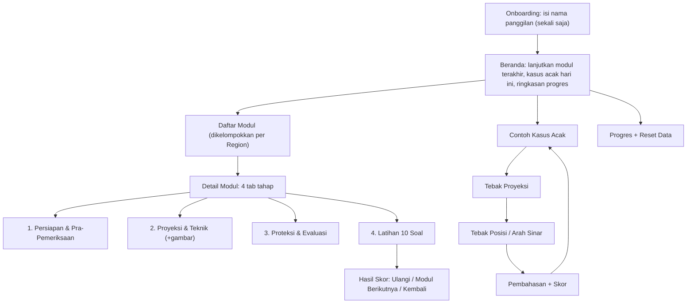
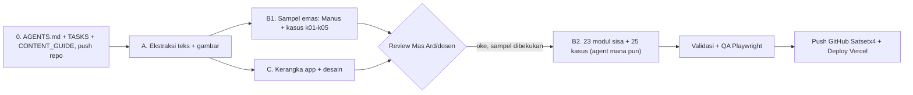

# RadPraktik — Rencana Implementasi

> **Status: DISETUJUI Ard (2026-11-23).** Kalau dokumen ini berbeda dengan `docs/CONTENT_GUIDE.md` soal konten, **CONTENT_GUIDE yang berlaku**. Skema di bawah ditambah field `tipe` & `sumber` (Soal), `faktorEksposi` & `sumber` (Proyeksi), dan `sumber` (Kasus).

Web app belajar interaktif dari **24 Modul Praktek Laboratorium Teknik Radiografi 1** (JTRR Poltekkes Kemenkes Semarang) di `D:\!AGY\modul_rad`. Isinya: materi per modul, 10 soal latihan pilihan ganda per modul (240 soal), dan 30 contoh kasus acak dengan tebakan bertahap.

## Lean PRD

| Aspek | Keputusan (hasil sesi tanya-jawab) |
|---|---|
| **Masalah** | Materi praktikum tersebar di 24 PDF panjang (204 halaman). Isinya susah diulang-ulang, dan tidak ada latihan soal maupun kasus. |
| **Pengguna** | Mahasiswa Teknik Radiologi D3/D4, untuk belajar mandiri dan persiapan praktikum/ujian |
| **Akses** | Tanpa login. Cukup isi nama panggilan sekali, progres tersimpan di perangkat (`localStorage`) |
| **Latihan soal** | Mode Latihan: tiap soal langsung muncul benar/salah + penjelasan, skor di akhir. Soal dan pilihan diacak tiap kali diulang |
| **Contoh kasus** | Section terpisah, 30 kasus diacak. Alurnya: tebak **Proyeksi** → tebak **Posisi/arah sinar** → pembahasan terbuka, ada skor per kasus |
| **Akurasi** | 100% bersumber dari PDF. Mas Ard/dosen mengecek sampel sebelum dirilis |
| **Progres** | Dashboard: bar per region, modul selesai, skor terbaik, akurasi kasus, daftar modul yang perlu diulang (skor < 70) |
| **Tampilan** | "Clinical Dark" ala ruang baca radiograf (negatoskop), aksen cyan/teal, ada toggle mode terang |
| **Rilis** | Nama **RadPraktik**, publik di **radpraktik.rindia.my.id** (Vercel scope `sekawan`), dengan credit sumber modul |

**Di luar cakupan MVP (bisa fase berikutnya):** login/akun, rekap nilai untuk dosen, mode ujian dengan timer, cetak rapor PDF.

---

## User Review Required

> [!IMPORTANT]
> **Dikerjakan beberapa agent (handoff lewat repo GitHub).** Rencana ini di-push ke repo dan bisa dieksekusi agent mana pun secara bergantian. Supaya hasilnya seragam, keseragaman **dikunci di dalam repo**, bukan di ingatan agent:
> 1. **`docs/CONTENT_GUIDE.md`**: aturan menulis materi, soal, dan kasus (gaya bahasa, panjang, sebaran tipe soal, aturan pengecoh, istilah baku).
> 2. **Sampel emas**: modul **Manus** (materi + 10 soal) dan **5 kasus pertama** jadi contoh acuan wajib yang ditiru agent berikutnya.
> 3. **`npm run validate`**: menolak konten yang melanggar aturan (jumlah, tipe, panjang, istilah, gambar). Agent tidak boleh menandai tugas selesai sebelum validator lolos.
> 4. **`AGENTS.md` + `docs/TASKS.md`**: urutan tugas dengan checkbox, definisi selesai per tugas, dan log handoff ("terakhir dikerjakan, lanjut dari mana").
>
> Gerbang review tetap ada. Setelah sampel emas jadi, Mas Ard/dosen mengecek dulu. Setelah disetujui, sampel itu dibekukan (tidak diubah lagi) dan 23 modul sisanya dikerjakan mengikuti sampel tersebut.

> [!WARNING]
> **Isi PDF ada yang salah ketik.** Contohnya di Orientasi: definisi PA tertulis "...keluar bagian *posterior*" (seharusnya *anterior*). Typo yang jelas akan saya perbaiki diam-diam. Kalau ada yang meragukan secara materi, tidak saya tebak, tapi saya kumpulkan di file `catatan-konten.md` untuk dicek dosen.

> [!NOTE]
> **Hak cipta.** Materi berasal dari modul JTRR Poltekkes Kemenkes Semarang. Credit ditampilkan di footer dan halaman Tentang. Kalau aplikasinya mau dipakai lebih luas dari lingkungan kampus, sebaiknya minta izin jurusan dulu.

## Keputusan Final

- **Domain:** **`https://radpraktik.rindia.my.id`**. `rindia.my.id` sudah terdaftar di Vercel scope `sekawan` dengan nameserver Vercel, jadi subdomain cukup ditambahkan lewat `vercel domains add radpraktik.rindia.my.id` di proyek, tanpa perlu atur DNS manual. URL ini dipakai untuk canonical, sitemap, dan OG.
- **Salah ketik di PDF:** typo yang jelas diperbaiki, yang meragukan dicatat di `docs/catatan-konten.md`.
- **Repo:** `github.com/Satsetx4/radpraktik` (publik), dengan `AGENTS.md` sebagai pintu masuk untuk agent lain.

---

## Arsitektur & Alur Layar



**Navigasi (anti-tersesat):**
- **Bottom nav** (HP), 4 menu: `Beranda` · `Modul` · `Kasus` · `Progres`. Di desktop jadi sidebar kiri.
- **AppHeader** di setiap sub-halaman: tombol kembali ≥44px di kiri, judul halaman, dan breadcrumb (`Modul › Ekstremitas Atas › Manus`).
- Tidak ada halaman buntu: setiap halaman hasil/kosong/error punya tombol lanjut.

### Rute
| Rute | Halaman |
|---|---|
| `/` | Beranda (onboarding modal kalau nama belum diisi) |
| `/modul` | Daftar region + modul |
| `/modul/:slug` | Detail modul (tab via `?tahap=proyeksi`) |
| `/modul/:slug/latihan` | Kuis 10 soal |
| `/kasus` | Kasus acak (berikutnya / acak ulang) |
| `/progres` | Dashboard progres + Reset Data |
| `/tentang` | Sumber, credit, cara pakai |
| `*` | 404 interaktif |

### Region → Modul
| Region | Modul |
|---|---|
| Dasar | 301-1 Orientasi |
| Ekstremitas Atas | 2A Manus, 2B Wrist, 3A Antebrachi, 3B Elbow, 4A Humerus, 4B Shoulder, 5A Clavicula, 5B Scapula |
| Ekstremitas Bawah | 6A Ossa Pedis, 6B Calcaneus, 7A Ankle, 7B Cruris, 8A Knee, 8B Patella, 9A Femur, 9B Collum Femur |
| Pelvis & Panggul | 10A Hip Joint, 10B Sacro-Iliac, 10C Pelvis |
| Vertebra | 11 Cervical, 12 Thoracal, 13 Lumbal, 14 Sacrum-Coccyg |

---

## Proposed Changes

Lokasi proyek: **`D:\!AGY\radpraktik`**. Folder PDF asli tidak diubah sama sekali.

### Tahap 0 — Fondasi Handoff (dikerjakan pertama, sebelum kode apa pun)

#### [NEW] `AGENTS.md`
Pintu masuk untuk agent mana pun: ringkasan proyek, aturan wajib (Golden Stack, anti-slop, setia ke PDF, Bahasa Indonesia), perintah penting (`npm run dev/validate/build/test`), dan perintah **"baca `docs/TASKS.md` lalu ambil tugas pertama yang belum dicentang"**.

#### [NEW] `docs/PLAN.md`
Salinan rencana yang sudah disetujui ini (sumber kebenaran desain).

#### [NEW] `docs/TASKS.md`
Daftar tugas berurutan dengan checkbox dan definisi selesai, contohnya:
```md
- [ ] T01 Ekstraksi teks → tools/raw/*.json (DoD: 24 file, tiap file punya section A–G)
- [ ] T02 Ekstraksi gambar → public/img (DoD: validator gambar lolos)
- [ ] T03 Kerangka app + desain + navigasi
- [ ] T04 SAMPEL EMAS: modul manus + 10 soal + kasus k01–k05  ⛔ STOP: tunggu review Ard
- [ ] T05 Ekstremitas Atas (7 modul sisa)
- [ ] T06 Ekstremitas Bawah (8 modul)
- [ ] T07 Pelvis + Dasar (4 modul)
- [ ] T08 Vertebra (4 modul)
- [ ] T09 Kasus k06–k30
- [ ] T10 QA Playwright + 20 pondasi
- [ ] T11 Deploy Vercel + domain radpraktik.rindia.my.id
## Log Handoff
| Tanggal | Agent | Tugas | Status | Catatan / lanjut dari mana |
```
Satu tugas = satu commit (`feat(T05): ...`). Tugas sengaja dibuat kecil supaya kalau kuota agent habis di tengah jalan, kerugiannya paling banyak satu tugas.

#### [NEW] `docs/CONTENT_GUIDE.md`
- **Gaya:** Bahasa Indonesia baku tapi ringan, kalimat aktif, istilah anatomi Latin sesuai PDF (`ossa manus`, `central ray`, `FFD`).
- **Sebaran 10 soal per modul (wajib):** 2 definisi/kompetensi · 3 posisi pasien & objek · 2 central ray/point · 1 kriteria radiograf · 1 proteksi radiasi · 1 urutan prosedur/pra-pemeriksaan. Ditandai dengan field `tipe`, dan validator mengecek sebarannya.
- **Pilihan:** 4 opsi, panjangnya setara (kunci jawaban tidak boleh selalu yang terpanjang), dilarang "semua benar/salah", pengecoh diambil dari proyeksi/modul lain.
- **Penjelasan:** 1–2 kalimat, menyebut alasan, maks 220 karakter.
- **Kasus:** skenario 60–110 kata (usia, mekanisme cedera, keluhan, kondisi pasien), 2 tahap tebakan × 4 opsi, pembahasan terstruktur. Tidak ada diagnosis di luar PDF.
- **Glosarium istilah baku** (misal `oblik` bukan `oblique`/`obliq`), dicek otomatis oleh validator.

### Tahap A — Pipeline Ekstraksi PDF (Python, sekali jalan)

> [!NOTE]
> Supaya agent di komputer lain tidak butuh folder `D:\!AGY\modul_rad`, ke-24 PDF (±10 MB) disalin ke `sources/pdf/` di repo, dan hasil ekstraksi (`tools/raw/*.json` + `public/img/`) juga ikut di-commit.

#### [NEW] `tools/extract.py`
- Membaca setiap PDF dengan PyMuPDF, lalu memecah teks berdasarkan heading baku yang sudah saya cek konsisten di semua modul: `A. Kompetensi`, `B. Administrasi`, `C. Pra pemeriksaan`, `D. Pelaksanaan Pemeriksaan` (sub: `1. Proyeksi ...`), `E. Proteksi radiasi`, `F. Pasca pemeriksaan`, `G. Evaluasi/Tugas`.
- Output: `tools/raw/<slug>.json` (teks per section + nomor halaman), jadi bahan menyusun konten.

#### [NEW] `tools/extract_images.py`
- Hasil survei: **186 gambar**. Yang dibuang: hiasan kecil (<80px, misal garis 27×3), gambar sampul berulang (1096×527), dan duplikat (dideteksi lewat hash).
- Setiap gambar dipetakan ke proyeksi terdekat berdasarkan posisinya di halaman (gambar di bawah heading "1. Proyeksi PA" masuk ke proyeksi PA).
- Dikonversi ke **WebP q85, lebar maks 900px** → `public/img/<slug>/<proyeksi>-<n>.webp`. Perkiraan total < 6 MB, dimuat lazy.

### Tahap B — Konten (data TypeScript bertipe)

#### [NEW] `src/data/types.ts`
```ts
export type RegionId = 'dasar' | 'ekstremitas-atas' | 'ekstremitas-bawah' | 'pelvis' | 'vertebra';

export interface Proyeksi {
  id: string;               // 'pa', 'lateral', 'oblik'
  nama: string;             // 'Proyeksi Posterior Anterior (PA)'
  posisiPasien: string[];
  posisiObjek: string[];
  centralRay: string;       // arah sinar
  centralPoint: string;     // titik bidik
  ffd?: string;             // dari PDF, kalau tercantum
  kaset?: string;
  kriteria: string[];       // kriteria radiograf
  gambar: { src: string; caption: string }[];
}

export interface Modul {
  slug: string;             // 'manus'
  kode: string;             // '301-2A'
  judul: string;
  region: RegionId;
  kompetensi: string;
  sorotan: string[];        // hal khas modul ini (supaya admin/pra-periksa tidak terasa mengulang)
  praPemeriksaan: { judul: string; poin: string[] }[];
  proyeksi: Proyeksi[];
  proteksi: string[];
  pascaPemeriksaan: string[];
  evaluasi: string[];
}

export interface Soal {
  id: string;               // 'manus-01'
  modul: string;
  tanya: string;
  pilihan: [string, string, string, string];
  kunci: 0 | 1 | 2 | 3;     // diacak saat tampil, kunci ikut dipetakan ulang
  penjelasan: string;
  sumber: string;           // 'hal 5' (internal)
}

export interface Kasus {
  id: string;               // 'k01'
  modulTerkait: string[];
  skenario: string;         // ±1 paragraf
  tahap1: { tanya: string; pilihan: string[]; kunci: number };  // proyeksi
  tahap2: { tanya: string; pilihan: string[]; kunci: number };  // posisi/arah sinar
  pembahasan: { proyeksi: string; posisi: string; centralRay: string; proteksi: string; catatan?: string };
}
```

#### [NEW] `src/data/modul/*.ts` (24 file), `src/data/soal/*.ts` (24 file), `src/data/kasus.ts`
- Disusun dari `tools/raw/*.json`. Untuk mempercepat, pengerjaan dibagi paralel per region.
- **Aturan soal:** variasi tipe (definisi, posisi pasien, central ray/point, kriteria evaluasi, proteksi, urutan prosedur). Pengecoh harus masuk akal (diambil dari proyeksi/modul lain). Tiap soal punya penjelasan 1–2 kalimat.
- **Aturan kasus:** 30 kasus tersebar di semua region (±6 per region besar). Skenario realistis (misal "pasien jatuh bertumpu tangan, nyeri di pergelangan..."), tapi jawabannya hanya dari proyeksi yang ada di PDF.

#### [NEW] `tools/validate-content.ts`
Pengecekan otomatis: total 24 modul, tiap modul tepat 10 soal, 30 kasus, `kunci` valid, tidak ada pilihan ganda kembar, semua path gambar ada filenya, ID unik, tidak ada teks placeholder.

### Tahap C — Aplikasi (Golden Stack)

React 19 + TypeScript + Vite, Tailwind v4, `motion` (Framer Motion), Lucide React, React Router 7, `@vercel/analytics`.

| File | Isi |
|---|---|
| `index.html` | Skrip boot tema anti-kedip di `<head>`, meta SEO/OG/Twitter, canonical, JSON-LD `Organization` + `WebSite`, slot verifikasi GSC, preload font |
| `src/lib/storage.ts` | Pembungkus `localStorage` dengan `try/catch` di semua operasi, key versi `radpraktik:v1:*`, fallback ke memori (aman di mode incognito) |
| `src/lib/progress.ts` | Store progres: `{ nama, tema, modulTerakhir, tahapTerakhir, modul: { [slug]: { dibaca: Tahap[], skorTerbaik, skorTerakhir, percobaan } }, kasus: { [id]: skor }, kuisAktif? }`, termasuk menyimpan kuis yang sedang berjalan supaya aman saat refresh |
| `src/lib/motion.ts` | Preset pegas terpusat (`stiffness 350, damping 28`), menghormati `useReducedMotion` |
| `src/lib/shuffle.ts` | Pengacak Fisher–Yates + pemetaan ulang kunci jawaban |
| `src/lib/track.ts` | Event Vercel Analytics: `mulai_latihan`, `selesai_latihan`, `buka_kasus`, `jawab_kasus`, `reset_data` |
| `src/components/` | `AppHeader`, `MobileBottomNav`, `Breadcrumbs`, `ThemeToggle`, `StageTabs` (`layoutId`), `ProjectionCard`, `ImageLightbox` (zoom, tombol X, tap luar untuk tutup), `QuizQuestion`, `ScoreRing`, `RegionBar` (bar mini in-view), `ErrorBoundary` |
| `src/pages/` | `Home`, `ModulList`, `ModulDetail`, `Latihan`, `Kasus`, `Progres`, `Tentang`, `NotFound` |
| `public/` | `favicon.svg` (ikon brand asli: kolimator/berkas sinar), `robots.txt`, `sitemap.xml` (dibuat otomatis saat build, berisi semua rute + 24 modul), `og.png` |
| `vercel.json` | Rewrite SPA + header cache untuk `/img` |

### Arah Desain "Clinical Dark"
- **Warna:** latar `#0B0F14` (hitam biru seperti ruang baca), permukaan kaca buram, aksen **cyan `#22D3EE`** + **teal `#14B8A6`**, amber `#F59E0B` untuk peringatan proteksi radiasi. Mode terang: latar putih tulang `#F6F7F4` dengan aksen teal lebih gelap, tetap lolos kontras AA.
- **Font:** **Space Grotesk** untuk judul (identitas), **IBM Plex Sans** untuk bacaan, **JetBrains Mono** untuk data teknis (FFD, sudut sinar, kode modul).
- **Ciri visual:** gambar proyeksi tampil di bingkai ala **negatoskop** (glow tipis di belakang gambar). Kartu proyeksi menampilkan "spesifikasi teknis" berbentuk chip (CR ⟂, FFD 100 cm, kaset 18×24).
- **Interaksi:** tombol membal saat ditekan (`scale .97`), kartu terangkat 2px saat hover, tab berpindah halus, pilihan jawaban bergoyang kalau salah dan berdenyut kalau benar, progress ring terisi saat skor muncul, bar region terisi saat masuk layar. Semua animasi 150–300ms.
- **Yang dihindari:** 3 kartu identik di bawah hero, gradien ungu-biru, emoji sebagai ikon, Inter/Roboto, data dummy. Kondisi awal benar-benar kosong (0%, nama kosong).

### Checklist 20 Pondasi (penyesuaian untuk app belajar)
Sitemap ✔ · robots ✔ · slot GSC ✔ · canonical per rute ✔ · breadcrumbs ✔ · internal link (modul berikutnya/sebelumnya, kasus ↔ modul terkait) ✔ · `Organization` + `WebSite` schema ✔ · OG/Twitter ✔ · zero `href="#"` ✔ · validasi form nama (wajib, 2–30 karakter, pesan ramah) ✔ · tracking event CTA ✔ · favicon asli ✔ · 404 interaktif ✔ · ErrorBoundary ✔ · tes 360px/tablet/desktop ✔.
*Tidak berlaku:* LocalBusiness schema, anti-spam form/Turnstile, dan tracking WA, karena app ini tidak punya form kirim data atau kontak.

---

## Urutan Kerja



---

## Verification Plan

### Automated Tests
- `npm run validate`: cek integritas konten (jumlah soal/kasus, kunci, path gambar, ID unik, tidak ada placeholder).
- `npm run build`: TypeScript strict tanpa error.
- `vitest`: unit test `shuffle` (kunci tetap benar setelah diacak), `storage` (tidak crash saat `localStorage` melempar error), `progress` (skor terbaik, reset).
- **Playwright** (skill `playwright-ui-qa`) di viewport 360, 768, 1440:
  - Onboarding → buka modul Manus → pindah 4 tab → kerjakan 10 soal → skor muncul → refresh → progres masih ada.
  - Kasus: tebak tahap 1 → tahap 2 → pembahasan terbuka → kasus berikutnya.
  - Toggle tema tidak berkedip saat reload, tidak ada scroll horizontal (`scrollWidth ≤ innerWidth`), tap target ≥44px, semua gambar termuat, 404 punya tombol pulang, Reset Data mengosongkan semuanya.

### Manual Verification (Mas Ard / dosen)
1. Cek sampel emas (modul Manus + 10 soal + 5 kasus) di gerbang T04, sebelum agent lain melanjutkan.
2. Setelah live: coba di HP sendiri dan pastikan materi dan gambar cocok dengan PDF.
3. Baca `catatan-konten.md` untuk keputusan materi yang perlu dicek dosen.
